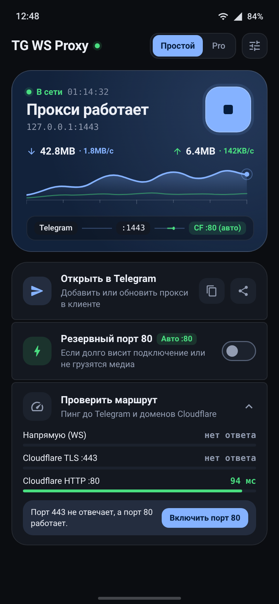
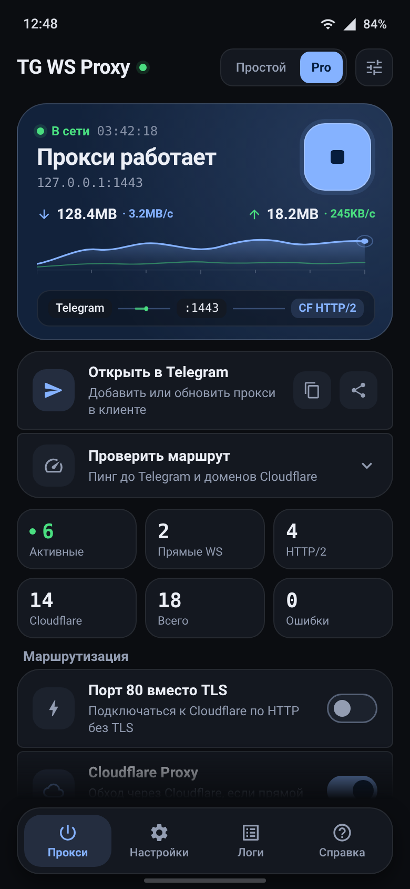
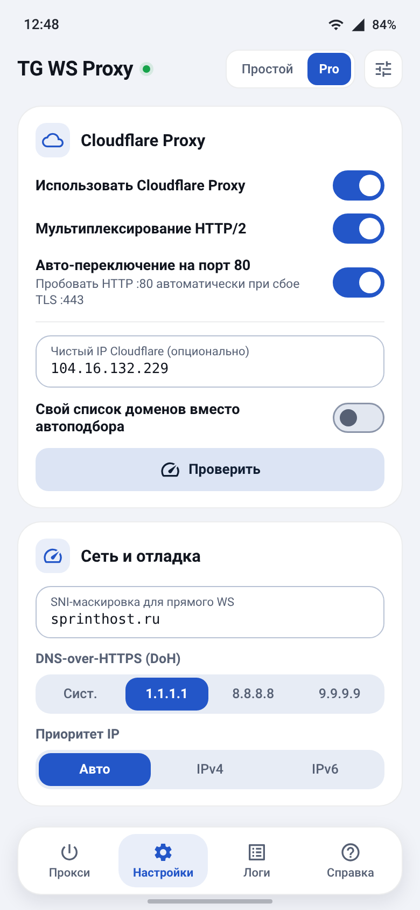

<div align="center">


# TG WS Proxy for Android

**Local MTProto WebSocket proxy for Telegram written in pure Kotlin (~1.9 MB)**<br />
No VPN slot, no root, no third-party proxy servers. Full protocol parity with [Flowseal/tg-ws-proxy](https://github.com/Flowseal/tg-ws-proxy) (`v1.12.0+`)<br />
and an actively maintained replacement for the archived `amurcanov/tg-ws-proxy-android`.

<p>
  <a href="README.md">🇷🇺 Русский</a> &nbsp;·&nbsp; <strong>🇬🇧 English</strong>
</p>

<p>
  <a href="https://github.com/Gramewa/tg-ws-proxy-android/releases/latest"></a>
  <a href="https://github.com/Gramewa/tg-ws-proxy-android/releases"></a>
  
  <a href="LICENSE"></a>
</p>

<p>
  <a href="https://github.com/Gramewa/tg-ws-proxy-android/releases/latest"></a>
  &nbsp;
  <a href="https://apps.obtainium.imranr.dev/redirect?r=obtainium://app/%7B%22id%22%3A%22io.github.tgwsproxy.android%22%2C%22url%22%3A%22https%3A%2F%2Fgithub.com%2FGramewa%2Ftg-ws-proxy-android%22%2C%22author%22%3A%22Gramewa%22%2C%22name%22%3A%22TG%20WS%20Proxy%22%7D"></a>
</p>

</div>

## Screenshots

<table>
  <tr>
    <td align="center" width="33%">
      <br />
      <sub><b>Simple mode</b> · auto :80 &amp; route check</sub>
    </td>
    <td align="center" width="33%">
      <br />
      <sub><b>Pro mode</b> · live stats &amp; routing</sub>
    </td>
    <td align="center" width="33%">
      <br />
      <sub><b>Light theme</b> · DoH, Clean IP &amp; auto :80</sub>
    </td>
  </tr>
</table>

## Highlights

- **~1.9 MB universal pure-Kotlin APK** — no heavy Rust/Python/Go runtimes and no ABI confusion. Runs on Android 8.0+ (API 26+).
- **Fast automatic port 80 fallback (`~750 ms`)** — when TLS on port `443` is blocked, the proxy automatically races and switches to plain HTTP `:80` (for both Cloudflare Proxy and custom CF Workers) while preserving Telegram's end-to-end MTProto encryption.
- **Full `Flowseal/tg-ws-proxy` (`v1.12.0+`) protocol parity** — direct WebSocket DC pools with customizable SNI fronting, Cloudflare Proxy with auto-updated cached domains and EWMA latency balancing, HTTP/2 media multiplexing, custom Cloudflare Workers with cooldown & quota tracking, built-in DoH (`1.1.1.1` / `8.8.8.8` / `9.9.9.9`), Happy Eyeballs, Clean Cloudflare IP, and Fake TLS (`ee` secret with `X25519MLKEM768` and replay-probe protection).
- **100% FOSS, zero tracking** — no ads, no analytics, no Google Play Services, no `REQUEST_INSTALL_PACKAGES`. Release APKs are built publicly in [GitHub Actions](.github/workflows/build.yml) with `SHA256SUMS.txt`.

## Quick Start

1. Download and install `tg-ws-proxy-android-*.apk` from the [latest release](https://github.com/Gramewa/tg-ws-proxy-android/releases/latest) (updates install cleanly in place without losing settings).
2. Open the app and tap the power button to start the local proxy.
3. Tap **Open in Telegram** (supports official Telegram, AyuGram, NekoGram, Plus Messenger, and other compatible clients).
4. If TLS `:443` is blocked on your network, the proxy switches to **`CF :80 (auto)`** within ~1 second. You can also toggle **Fallback port 80** manually or run **Check route** right from the home screen.

> [!TIP]
> To prevent Android from killing the background service when the screen is off, use the quick battery-optimization button on the main screen.

## How It Works

```text
Telegram (Android) ──► Local MTProto (127.0.0.1:1443) ──► WebSocket / HTTP :80 (Direct or Cloudflare) ──► Telegram DC
```

The proxy runs entirely on your device, does not use Android's VPN slot, and does not touch traffic from other apps.

## Security & Privacy

- **Localhost-only by default:** listens on `127.0.0.1:1443` only; switching to `0.0.0.0` shows an explicit warning.
- **Minimal FOSS dependencies:** pure AndroidX, Kotlin Coroutines, and OkHttp ([app/build.gradle.kts](app/build.gradle.kts)); `dependenciesInfo` disabled for reproducible IzzyOnDroid / F-Droid verification.
- **Secret hygiene:** `allowBackup="false"`, secrets and custom domains are redacted from logs and `logcat`, clipboard proxy links are marked sensitive on Android 13+.
- **Transparent builds:** see [SECURITY.md](SECURITY.md) and [build.yml](.github/workflows/build.yml).

## All Features

- **Simple & Pro UI modes:** clean one-tap home screen with live throughput wave, active route indicator, and inline route latency diagnostics, plus a Pro mode with detailed transport counters, granular networking controls, JSON config export/import, and live logs.
- **Engine optimizations:** zero-copy AES-CTR relay, pre-warmed Cloudflare WebSocket pools, early client-disconnect dial cancellation, and instant hot-reload settings without restarting the local socket.
- **Android comfort:** automatic recovery across Wi-Fi / cellular / VPN transitions, Quick Settings tile with live route status, boot autostart, GitHub update check, dark & light themes + Material You (Android 12+), and English / Russian UI.

## Building from Source

```bash
./gradlew testDebugUnitTest assembleRelease
```

Requires JDK 17 and Android SDK (API 35).

## License

[MIT License](LICENSE). Based on the [Flowseal/tg-ws-proxy](https://github.com/Flowseal/tg-ws-proxy) protocol (see [NOTICE](NOTICE)).
