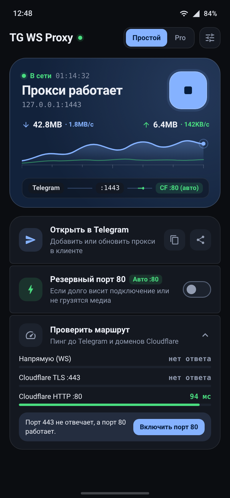
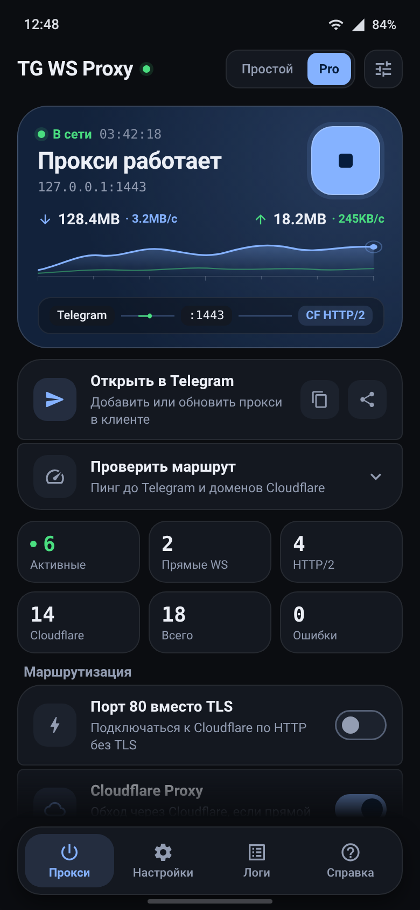

# tg-ws-proxy-android

Android-версия локального MTProto WebSocket-прокси по протоколу [Flowseal/tg-ws-proxy](https://github.com/Flowseal/tg-ws-proxy). Написана на чистом Kotlin без тяжёлых нативных библиотек как живая замена заброшенному стороннему форку.

- **Скачать APK:** [последний релиз на GitHub](https://github.com/Gramewa/tg-ws-proxy-android/releases/latest) (Android 8.0+)
- **Обновлять через Obtainium:** [добавить в один клик](https://apps.obtainium.imranr.dev/redirect?r=obtainium://app/%7B%22id%22%3A%22io.github.tgwsproxy.android%22%2C%22url%22%3A%22https%3A%2F%2Fgithub.com%2FGramewa%2Ftg-ws-proxy-android%22%2C%22author%22%3A%22Gramewa%22%2C%22name%22%3A%22TG%20WS%20Proxy%22%7D)

## Интерфейс

<table>
  <tr>
    <td align="center" width="33%">
       
      <b>Простой режим</b> · авто :80 и диагностика
    </td>
    <td align="center" width="33%">
       
      <b>Pro-режим</b> · статистика и маршруты
    </td>
    <td align="center" width="33%">
       
      <b>Светлая тема</b> · DoH, чистый IP и авто :80
    </td>
  </tr>
</table>

## Как подключить

1. Установите `tg-ws-proxy-android-*.apk` (обновления ставятся поверх прошлой версии без потери настроек).
2. Нажмите кнопку запуска на главном экране.
3. Нажмите **Открыть в Telegram** (подходят официальный клиент, AyuGram, NekoGram, Plus Messenger и другие).
4. При блокировке TLS на порту 443 прокси сам переключится на резервный **HTTP :80** за ~1 секунду (в интерфейсе появится зелёный индикатор **`CF :80 (авто)`** и бейдж **`Авто :80`**). Также на главной есть ручной тумблер **Резервный порт 80** и встроенная проверка **Проверить маршрут**.

Чтобы система не останавливала прокси при выключенном экране, на главном экране есть быстрая кнопка снятия ограничений батареи.

## Возможности

- **Два режима в шапке:** **Простой** (запуск, живой маршрут и волна трафика, передача прокси в Telegram, порт 80 и быстрый пинг маршрутов) и **Pro** (подробная статистика соединений, гибкие настройки сети, экспорт/импорт JSON-конфига и логи).
- **Быстрый обход и стабильность:**
  - полная совместимость с `Flowseal/tg-ws-proxy` (`v1.12.0+`): прямой пул WebSocket к DC с настраиваемым SNI-fronting, резерв через Cloudflare Proxy с автообновлением и кешированием доменов, мультиплексирование медиа по HTTP/2, свои Cloudflare Worker (с авто-fallback на HTTP `:80` и cooldown при лимитах/сбоях) и Fake TLS (`ee`-секрет с `X25519MLKEM768` и защитой от replay-пробинга);
  - автоматическое переключение на HTTP `:80` с параллельной гонкой (`~750 мс`) и запоминанием блокировки TLS на всю сеть;
  - встроенный **DNS-over-HTTPS (DoH)** (`1.1.1.1`, `8.8.8.8`, `9.9.9.9`), выбор приоритета `Авто / IPv4 / IPv6`, опциональный **чистый IP Cloudflare**, Happy Eyeballs и умный балансировщик доменов по задержке (EWMA);
  - оптимизированный zero-copy криптодвижок AES-CTR + пре-пул соединений Cloudflare, ранняя отмена upstream-подключений при разрыве клиента и мгновенное применение настроек (hot-reload) без перезапуска локального сокета.
- **Комфорт на Android:** автоматический сброс зависших сокетов при смене Wi-Fi/мобильной сети/VPN, экономия батареи в простое и при выключенном экране, плитка в шторке Android с живым статусом маршрута, автозапуск, проверка обновлений с GitHub, тёмная и светлая тема + Material You (Android 12+).

## Если плохо грузятся медиа

- Обычно достаточно подождать ~1 секунду — при сбое TLS `:443` прокси автоматически перейдёт на **`CF :80 (авто)`**.
- Чтобы всегда ходить через порт 80 без предварительной проверки TLS, включите **Резервный порт 80** на главном экране (аналог `--no-secure` на ПК; внутреннее шифрование MTProto полностью сохраняется).
- В сложных сетях откройте **Pro → Настройки**: попробуйте включить **DNS-over-HTTPS (1.1.1.1)**, указать свой **чистый IP Cloudflare** или в блоке **Датацентры (DC:IP)** нажать **Очистить (всё в CF)** и **Применить**.

---

## English

**Telegram MTProto WebSocket Proxy for Android** is an actively maintained pure-Kotlin port of [Flowseal/tg-ws-proxy](https://github.com/Flowseal/tg-ws-proxy).

- **Download APK:** [Latest GitHub Release](https://github.com/Gramewa/tg-ws-proxy-android/releases/latest) (Android 8.0 / API 26+)
- **Obtainium:** [Add to Obtainium](https://apps.obtainium.imranr.dev/redirect?r=obtainium://app/%7B%22id%22%3A%22io.github.tgwsproxy.android%22%2C%22url%22%3A%22https%3A%2F%2Fgithub.com%2FGramewa%2Ftg-ws-proxy-android%22%2C%22author%22%3A%22Gramewa%22%2C%22name%22%3A%22TG%20WS%20Proxy%22%7D)

Features full protocol parity with desktop `tg-ws-proxy` (`v1.12.0+`): direct WebSocket DC pools with customizable SNI fronting, Cloudflare Proxy fallback with auto-updated cached domains and EWMA latency balancing, pre-warmed CF WebSocket pools, HTTP/2 media multiplexing, fast automatic plain port `80` fallback (`~750ms` staggered race with live UI/notification indicator) for both CF Proxy and custom Cloudflare Workers, worker cooldown & quota tracking, manual `--no-secure` mode, built-in DNS-over-HTTPS (`1.1.1.1` / `8.8.8.8` / `9.9.9.9`), IPv4/IPv6 preference & Happy Eyeballs, optional Clean Cloudflare IP, Fake TLS (`ee` secret with `X25519MLKEM768` and replay-probe protection), early client-disconnect dial cancellation, zero-copy AES-CTR relay, live hot-reload settings, inline route latency diagnostics, automatic Wi-Fi/cellular/VPN recovery, JSON config export/import, Quick Settings tile, Simple/Pro modes, Material You support, and English/Russian UI.

## License

MIT ([LICENSE](LICENSE)), based on [Flowseal/tg-ws-proxy](https://github.com/Flowseal/tg-ws-proxy).
