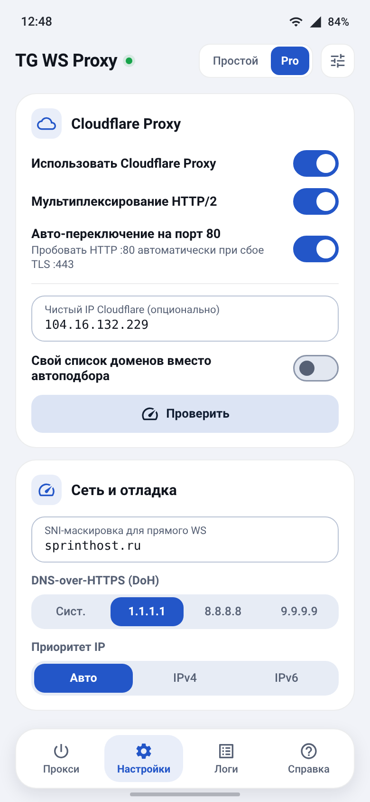

<div align="center">


# TG WS Proxy для Android

**Локальный MTProto WebSocket-прокси для Telegram на чистом Kotlin (~1.9 МБ)**<br />
Без VPN, без root и без сторонних серверов. Полная совместимость с [Flowseal/tg-ws-proxy](https://github.com/Flowseal/tg-ws-proxy) (`v1.12.0+`)<br />
и живая замена заархивированному `amurcanov/tg-ws-proxy-android`.

<p>
  <strong>🇷🇺 Русский</strong> &nbsp;·&nbsp; <a href="README.en.md">🇬🇧 English</a>
</p>

<p>
  <a href="https://github.com/Gramewa/tg-ws-proxy-android/releases/latest"></a>
  <a href="https://github.com/Gramewa/tg-ws-proxy-android/releases"></a>
  
  <a href="LICENSE"></a>
</p>

<p>
  <a href="https://github.com/Gramewa/tg-ws-proxy-android/releases/latest"></a>
  &nbsp;
  <a href="https://apps.obtainium.imranr.dev/redirect?r=obtainium://app/%7B%22id%22%3A%22io.github.tgwsproxy.android%22%2C%22url%22%3A%22https%3A%2F%2Fgithub.com%2FGramewa%2Ftg-ws-proxy-android%22%2C%22author%22%3A%22Gramewa%22%2C%22name%22%3A%22TG%20WS%20Proxy%22%7D"></a>
</p>

</div>

## Интерфейс

<table>
  <tr>
    <td align="center" width="33%">
      <br />
      <sub><b>Простой режим</b> · авто :80 и диагностика</sub>
    </td>
    <td align="center" width="33%">
      <br />
      <sub><b>Pro-режим</b> · статистика и маршруты</sub>
    </td>
    <td align="center" width="33%">
      <br />
      <sub><b>Светлая тема</b> · DoH, чистый IP и авто :80</sub>
    </td>
  </tr>
</table>

## Почему эта версия

- **~1.9 МБ universal APK на чистом Kotlin** — никаких тяжёлых Rust/Python/Go-бинарников и путаницы с архитектурами (`arm64`/`armv7`). Работает на всех устройствах Android 8.0+.
- **Автоматический обход блокировок TLS (`:443 → :80`) за ~750 мс** — при сбое TLS на 443-м порту прокси сам переключается на резервный **HTTP `:80`** (для Cloudflare Proxy и своих CF Workers) с сохранением внутреннего шифрования MTProto.
- **Паритет с `Flowseal/tg-ws-proxy` (`v1.12.0+`)** — встроенный **DoH** (`1.1.1.1` / `8.8.8.8` / `9.9.9.9`), HTTP/2-мультиплексирование для медиа, опциональный чистый IP Cloudflare, Happy Eyeballs и Fake TLS (`ee` + `X25519MLKEM768`).
- **Открытый код и ноль трекеров** — без рекламы, аналитики и Google Play Services. Релизные APK собираются публично в [GitHub Actions](.github/workflows/build.yml) с контрольными суммами `SHA256SUMS.txt`.

## Как подключить

1. Скачайте и установите `tg-ws-proxy-android-*.apk` из [последнего релиза](https://github.com/Gramewa/tg-ws-proxy-android/releases/latest) (обновления ставятся поверх прошлой версии без потери настроек).
2. Откройте приложение и нажмите кнопку запуска на главном экране.
3. Нажмите **Открыть в Telegram** — подходят официальный клиент, AyuGram, NekoGram, Plus Messenger и другие.
4. При блокировке TLS на порту 443 прокси сам переключится на резервный **HTTP `:80`** за ~1 секунду (в интерфейсе появится зелёный индикатор **`CF :80 (авто)`** и бейдж **`Авто :80`**). Также на главной есть ручной тумблер **Резервный порт 80** и встроенная проверка **Проверить маршрут**.

> [!TIP]
> Чтобы Android не останавливал прокси при выключенном экране, нажмите быструю кнопку снятия ограничений батареи на главном экране.

## Если плохо грузятся медиа

- Обычно достаточно подождать ~1 секунду — при сбое TLS `:443` прокси автоматически перейдёт на **`CF :80 (авто)`**.
- Чтобы всегда ходить через порт 80 без предварительной проверки TLS, включите **Резервный порт 80** на главном экране (аналог `--no-secure` на ПК; внутреннее шифрование MTProto полностью сохраняется).
- В сложных сетях откройте **Pro → Настройки**: попробуйте включить **DNS-over-HTTPS (`1.1.1.1`)**, указать свой **чистый IP Cloudflare** или в блоке **Датацентры (`DC:IP`)** нажать **Очистить (всё в CF)** и **Применить**.

## Как это работает

```text
Telegram (Android) ──► Локальный MTProto (127.0.0.1:1443) ──► WebSocket / HTTP :80 (Direct или Cloudflare) ──► Telegram DC
```

Прокси работает локально на телефоне, не занимает VPN-слот Android и не затрагивает трафик других приложений. Трафик Telegram остаётся зашифрованным протоколом MTProto на всём пути до серверов Telegram.

## Безопасность и приватность

- **Только `localhost` по умолчанию:** прокси слушает `127.0.0.1:1443` и не открывает порт в локальную сеть, пока вы сами не смените адрес.
- **Никакой телеметрии и чужих SDK:** в [app/build.gradle.kts](app/build.gradle.kts) только стандартные библиотеки AndroidX, Kotlin Coroutines и OkHttp; разрешение `REQUEST_INSTALL_PACKAGES` не запрашивается.
- **Защита секретов:** `allowBackup="false"`, параметры `secret=` и сторонние домены скрываются из логов и `logcat`.
- **Прозрачная сборка:** все релизные APK собираются в [GitHub Actions](.github/workflows/build.yml) с публикацией `SHA256SUMS.txt`. Подробнее — в [SECURITY.md](SECURITY.md).

## Все возможности

- **Два режима в шапке:** **Простой** (запуск, живой маршрут и волна трафика, передача прокси в Telegram, порт 80 и быстрый пинг маршрутов) и **Pro** (подробная статистика соединений, гибкие настройки сети, экспорт/импорт JSON-конфига и логи).
- **Быстрый обход и стабильность:**
  - полная совместимость с `Flowseal/tg-ws-proxy` (`v1.12.0+`): прямой пул WebSocket к DC с настраиваемым SNI-fronting, резерв через Cloudflare Proxy с автообновлением и кешированием доменов, мультиплексирование медиа по HTTP/2, свои Cloudflare Worker (с авто-fallback на HTTP `:80` и cooldown при лимитах/сбоях) и Fake TLS (`ee`-секрет с `X25519MLKEM768` и защитой от replay-пробинга);
  - автоматическое переключение на HTTP `:80` с параллельной гонкой (`~750 мс`) и запоминанием блокировки TLS на всю сеть;
  - встроенный **DNS-over-HTTPS (DoH)** (`1.1.1.1`, `8.8.8.8`, `9.9.9.9`), выбор приоритета `Авто / IPv4 / IPv6`, опциональный **чистый IP Cloudflare**, Happy Eyeballs и умный балансировщик доменов по задержке (EWMA);
  - оптимизированный zero-copy криптодвижок AES-CTR + пре-пул соединений Cloudflare, ранняя отмена upstream-подключений при разрыве клиента и мгновенное применение настроек (hot-reload) без перезапуска локального сокета.
- **Комфорт на Android:** автоматический сброс зависших сокетов при смене Wi-Fi/мобильной сети/VPN, экономия батареи в простое и при выключенном экране, плитка в шторке Android с живым статусом маршрута, автозапуск, проверка обновлений с GitHub, тёмная и светлая тема + Material You (Android 12+), русский и английский интерфейс.

## Сборка из исходников

```bash
./gradlew testDebugUnitTest assembleRelease
```

Требуется JDK 17 и Android SDK (API 35).

## Лицензия

[MIT License](LICENSE). Основано на протоколе [Flowseal/tg-ws-proxy](https://github.com/Flowseal/tg-ws-proxy) (см. [NOTICE](NOTICE)).
